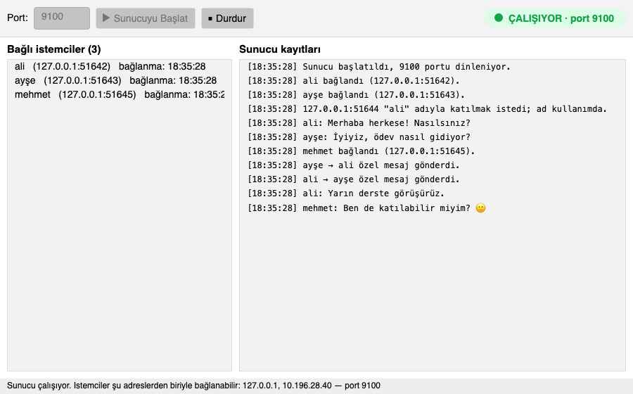
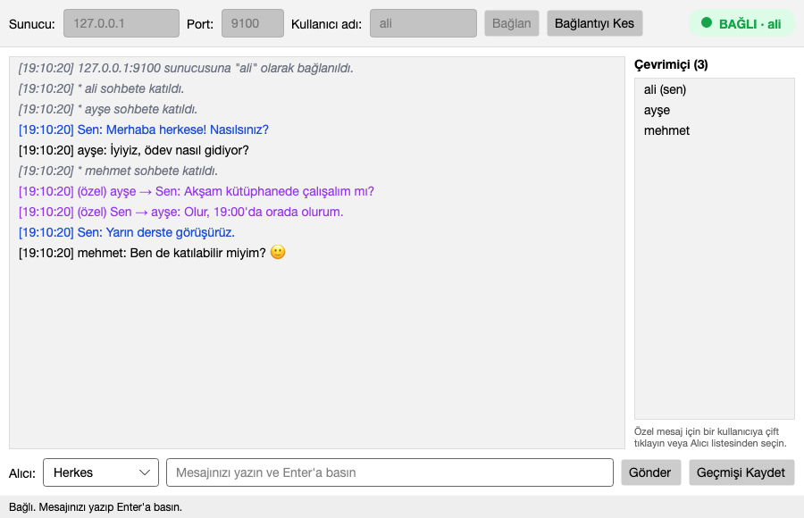
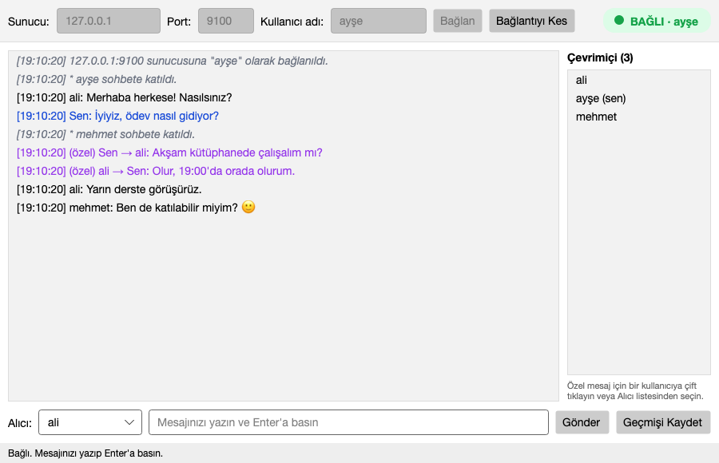
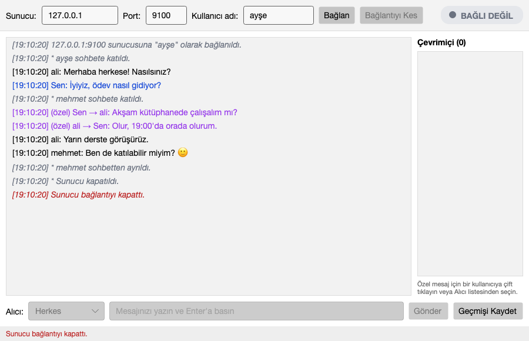

# YMH219 - İstemci-Sunucu Chat Uygulaması

Nesne Tabanlı Programlama (YMH 219) dersi ek uygulama ödevi. TCP/IP üzerinde çalışan, bir **sunucu** ve birden fazla **istemci** uygulamasından oluşan sohbet sistemi. İstemciler kullanıcı adıyla bağlanır; herkese açık veya kişiye özel mesaj gönderebilir. Sunucu bağlı istemcileri ve olayları listeler.

## Kullanılan Teknolojiler

- C# / .NET 8
- `TcpListener` / `TcpClient` ile TCP/IP iletişimi
- `NetworkStream` + `StreamReader` / `StreamWriter` ile satır tabanlı mesajlaşma
- `async` / `await` ile asenkron bağlantı kabulü, mesaj dinleme ve gönderme
- `System.Text.Json` ile mesaj biçimi (her mesaj tek satır JSON)
- [Avalonia UI](https://avaloniaui.net/) 11.2 — çapraz platform masaüstü arayüz kütüphanesi
- NuGet paketleri: `Avalonia`, `Avalonia.Desktop`, `Avalonia.Themes.Fluent`

> Ders föyünde ortam olarak Windows Forms belirtilmiştir; dersin hocasından WinForms'un zorunlu olmadığı onayı alınarak macOS'ta da çalışabilmesi için Avalonia tercih edilmiştir.

## Kurulum ve Çalıştırma

**Gereksinimler:** [.NET 8 SDK](https://dotnet.microsoft.com/download) (Windows, macOS veya Linux). NuGet paketleri ilk derlemede otomatik indirilir.

```bash
git clone https://github.com/insaninsan/chat-app.git
cd chat-app
```

1. **Sunucuyu başlatın** (bir terminalde):
   ```bash
   dotnet run --project ChatServer
   ```
   Açılan pencerede portu (varsayılan `9000`) kontrol edip **▶ Sunucuyu Başlat**'a basın. Durum çubuğunda bu bilgisayarın IP adresleri görünür.

2. **İstemcileri başlatın** (her istemci için ayrı bir terminalde):
   ```bash
   dotnet run --project ChatClient
   ```
   Sunucu adresini, portu ve kullanıcı adını girip **Bağlan**'a basın.
   - Aynı bilgisayarda: sunucu adresi `127.0.0.1`
   - Aynı yerel ağdaki başka bir bilgisayardan: sunucu penceresinde yazan IP adresi (ör. `192.168.1.20`)

Visual Studio / Rider ile: `ChatApp.sln` dosyasını açın, önce `ChatServer`, sonra `ChatClient` projesini çalıştırın.

> Başka bir bilgisayardan bağlanırken işletim sisteminin güvenlik duvarı sunucu için izin isteyebilir; izin verilmesi gerekir.

## Özellikler

**Sunucu**
- Belirtilen portta bağlantı kabul eder; her istemci ayrı bir asenkron görevde dinlenir
- Bağlı istemcilerin kullanıcı adı, IP adresi:portu ve bağlanma saati listelenir
- Bağlanma, ayrılma, mesaj ve hata olayları zaman bilgisiyle kaydedilir
- Aynı kullanıcı adıyla ikinci kez katılım reddedilir (büyük/küçük harf duyarsız)
- 10 saniye içinde kullanıcı adı göndermeyen bağlantılar kapatılır
- Özel mesajların **içeriği** sunucu kaydına yazılmaz, yalnızca kimin kime gönderdiği yazılır
- Sunucu durdurulduğunda tüm istemcilere bildirim gönderilir

**İstemci**
- Sunucu adresi, port ve kullanıcı adı ile bağlanma; Bağlan / Mesaj Gönder / Bağlantıyı Kes
- Gönderilen ve alınan mesajlar zaman bilgisiyle gösterilir (kendi mesajları mavi, özel mesajlar mor, bildirimler gri)
- Çevrimiçi kullanıcılar listesi anlık güncellenir
- **Birden fazla istemci aynı odada** konuşabilir
- **Özel mesaj:** "Alıcı" listesinden bir kullanıcı seçilerek veya kullanıcı listesinde çift tıklanarak
- **Sohbet geçmişini .txt dosyasına kaydetme**
- Enter tuşu ile mesaj gönderme

**Hata yönetimi:** Sunucuya ulaşılamaması, zaman aşımı, kullanıcı adının reddedilmesi, bağlantının kopması veya sunucunun kapanması durumlarında uygulama kapanmaz; sebep mesaj listesinde ve durum çubuğunda kırmızı olarak gösterilir, kullanıcı tekrar bağlanabilir.

## Proje Yapısı

```
ChatApp.sln
├── ChatApp.Shared/              Sunucu ve istemcinin ortak kullandığı kütüphane
│   ├── MessageType.cs           Mesaj türleri (Join, Chat, Private, System, UserList...)
│   ├── ChatMessage.cs           Mesaj sınıfı, fabrika metotları ve JSON dönüşümü
│   ├── MessageConnection.cs     TcpClient üzerinde StreamReader/StreamWriter ile mesaj gönderme/alma
│   └── ChatDefaults.cs          Varsayılan port, sınırlar ve doğrulama kuralları
├── ChatServer/
│   ├── Services/ChatServerHost.cs   TcpListener, istemci yönetimi, yayın ve özel mesaj
│   ├── Models/ConnectedClient.cs    Bağlı bir istemcinin bilgileri
│   └── MainWindow.axaml(.cs)        Sunucu penceresi
└── ChatClient/
    ├── Services/ChatClientService.cs      Bağlanma, dinleme döngüsü, gönderme, kopma algılama
    ├── Services/ChatConnectionException.cs Kullanıcıya gösterilecek bağlantı hataları
    ├── Services/ChatHistoryWriter.cs       Geçmişi StreamWriter ile dosyaya yazma
    ├── Models/ChatLine.cs                  Mesaj listesindeki bir satır
    └── MainWindow.axaml(.cs)               İstemci penceresi
```

`ChatServerHost` ve `ChatClientService` arayüzden bağımsızdır; pencereler bunların olaylarını (`Log`, `ClientsChanged`, `MessageReceived`, `Disconnected`) dinler. Bu olaylar arka plan görevlerinden geldiği için arayüz `Dispatcher.UIThread.Post` ile UI iş parçacığında güncellenir.

### Mesaj protokolü

Her mesaj tek satırlık bir JSON nesnesidir; satır sonu mesajın bittiğini gösterir:

```json
{"Type":"Join","From":"ali","Timestamp":"0001-01-01T00:00:00"}
{"Type":"Chat","From":"ali","Text":"Merhaba!","Timestamp":"2026-11-25T18:35:28.1"}
{"Type":"Private","From":"ayşe","To":"ali","Text":"Selam","Timestamp":"2026-11-25T18:35:28.2"}
{"Type":"UserList","Users":["ali","ayşe"],"Timestamp":"2026-11-25T18:35:28.3"}
```

1. İstemci bağlanınca ilk mesaj olarak `Join` gönderir.
2. Sunucu `JoinAccepted` veya gerekçesiyle `JoinRejected` döner.
3. İstemci `Chat` / `Private` istekleri gönderir; gönderen adını ve zamanı **sunucu** ekler, böylece herkes mesajları aynı sırada ve aynı saatle görür.
4. Sunucu katılma/ayrılmalarda `System` bildirimi ve güncel `UserList` yayınlar.

## Ekran Görüntüleri

| Sunucu | İstemci (ali) |
|---|---|
|  |  |

| İstemci (ayşe) | Sunucu kapandıktan sonra istemci |
|---|---|
|  |  |

## Bilinen Sınırlamalar / Geliştirme Notları

- İletişim şifrelenmez (düz TCP); yalnızca güvenilir yerel ağda kullanılmalıdır.
- Kimlik doğrulama yoktur; kullanıcı adı yalnızca odada benzersiz olmalıdır.
- Tek bir oda vardır; mesajlar sunucuda saklanmaz, yeni katılan kullanıcı eski mesajları görmez.
- Mesaj uzunluğu en fazla 1000 karakterdir; kullanıcı adı en fazla 20 karakterdir.
- macOS'ta 5000 portu sistem (AirPlay) tarafından kullanıldığı için varsayılan port 9000 seçilmiştir.

## Öğrenci

- **Ad Soyad:** _<Adınız Soyadınız>_
- **Öğrenci No:** _<Öğrenci numaranız>_
